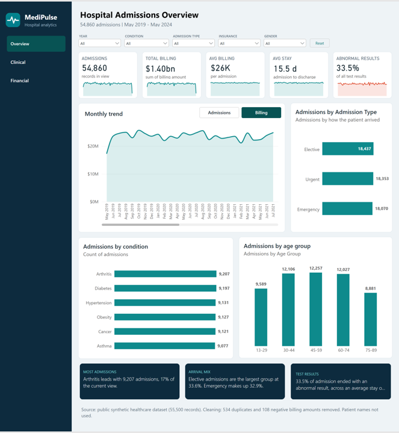
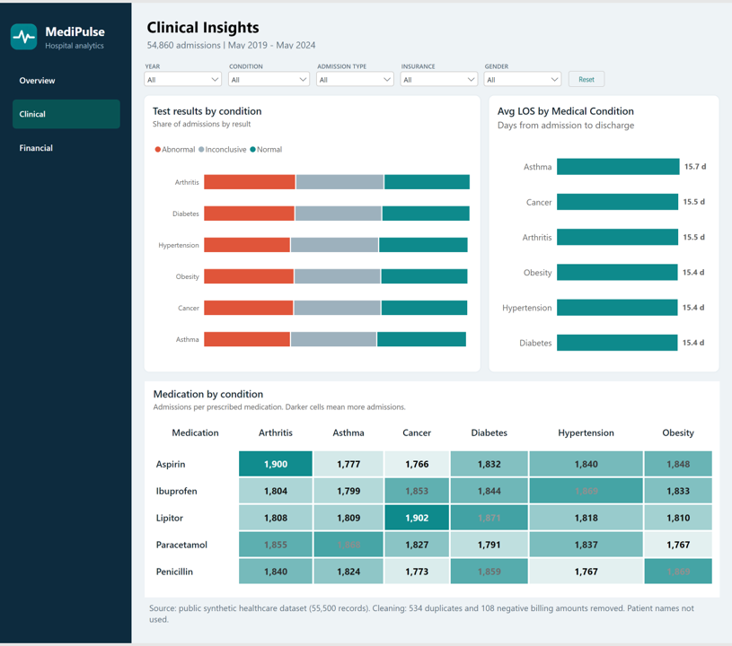
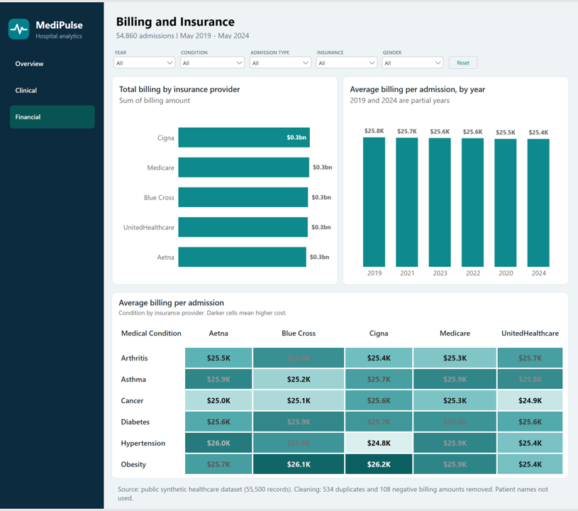

# Healthcare Admissions Dashboard (Power BI)

An interactive, app-style Power BI dashboard that analyses hospital admissions, clinical outcomes, billing and insurance mix. Built as Healthcare Project 1 in my analytics portfolio.

> Data note: the dataset is a public **synthetic** healthcare dataset (55,500 records), so the numbers are illustrative, not real patient data. The project demonstrates the build: data cleaning, modelling, DAX and report design.

## Preview

## Business questions answered

| Page | Questions |
|---|---|
| Overview | How many admissions are there, how do they trend by month, and how do they split by condition, admission type and age group? |
| Clinical | How do test results (normal, abnormal, inconclusive) vary by condition? How long do patients stay? Which medications are used for which conditions? |
| Financial | How much is billed per insurer and per year? What is the average cost per admission for each condition and insurer? |

Five slicers (year, condition, admission type, insurance, gender) are synced across all pages, and a Reset button clears them.

## Key numbers (after cleaning)

- 54,860 admissions, May 2019 to May 2024
- About $1.40B total billing, about $25.6K average per admission
- 15.5 days average length of stay
- 33.5% of admissions ended with an abnormal test result

## Data preparation (Power Query)

| Step | Rows |
|---|---|
| Loaded CSV | 55,500 |
| Removed 534 exact duplicate rows (all columns compared) | 54,966 |
| Removed 108 negative billing amounts | 54,860 |

Patient names, doctors, hospitals and room numbers are dropped because the dashboard does not use them. Added columns: length of stay, age group and a sort key for the age group.

## Data model and DAX

- Star schema: `Fact_Admissions` plus a `Dim_Date` table marked as the date table.
- Core measures: Admissions, Total Billing, Avg Billing, Avg LOS, Abnormal Rate, Emergency Share.
- A field parameter toggles the trend chart between admissions and billing.
- Dynamic insight cards: DAX text measures that rewrite themselves as the filters change.

## Performance tuning

I profiled the report with Performance Analyzer. DAX queries were fast (about 19 ms on average), so the bottleneck was the number of visuals redrawn on each click, not the data model.

## Repository contents

| Path | What it is |
|---|---|
| `powerbi/` | The .pbix report and the custom theme (`MediPulse_theme.json`) |
| `queries/Fact_Admissions.m` | The Power Query cleaning script |
| `dax/Measures.dax` | The DAX measures and date table |
| `data/healthcare_dataset.csv` | The synthetic source data |
| `screenshots/` | Report page images |

## How to open it

1. Download `powerbi/Healthcare_Dashboard.pbix`.
2. Open it in Power BI Desktop (free).
3. If prompted, point the data source to `data/healthcare_dataset.csv`.

## Tools

Power BI Desktop, Power Query (M), DAX

## Author

Aravind Thumma | [LinkedIn profile]([https://www.linkedin.com/in/aravind-thumma-analyticsengineer/])
